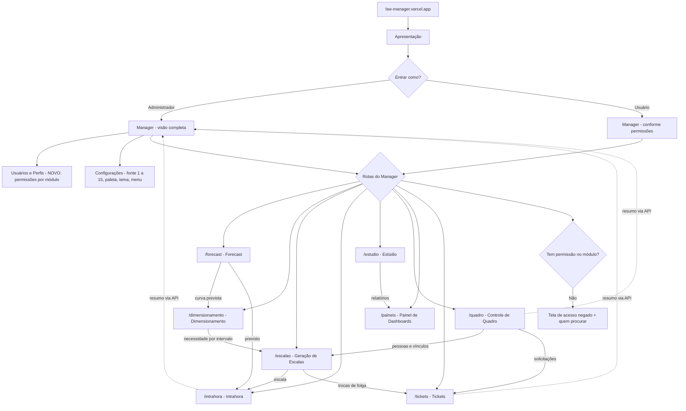

# LSW Manager — contexto e plano de construção

> Arquivo para o Claude Code (VS Code). Fica na **raiz do repositório `lsw-manager`**, e o Claude Code lê automaticamente em toda sessão. Quando um módulo começar a ser construído, ele ganha um `CLAUDE.md` próprio dentro da sua pasta (`apps/<modulo>/CLAUDE.md`).
> Versão 2 — 11/11/2026. Gerado a partir do planejamento feito no claude.ai (skill `planejar-construcao`).
> Dono: Leandro Almeida · marca **Logic Synapse Web (LSW)** · conta Google **logicsynapsesweb@gmail.com** (é a mesma conta que antes se chamava l.almeida.grupoelo@gmail.com).

---

## 1. Regras de trabalho (vêm do Leandro — seguir sempre)

1. **Um passo de cada vez.** Só avance depois que o Leandro validar ou tirar as dúvidas.
2. Em cada mudança, explique **o que acontece, como e por quê**, em português e sem jargão solto. Quando um termo técnico for inevitável, explique em meia linha.
3. **Leia os arquivos antes de opinar.** Não peça o que já está no código ou neste arquivo.
4. Mostre o trecho **antes/depois** e diga onde fica. No fim, peça **um teste concreto** e espere o resultado.
5. Se algo der erro, peça a **mensagem exata** em vez de adivinhar.
6. **Nunca peça nem mostre chaves, tokens ou senhas.** Só os nomes das variáveis.
7. Mantenha a **lista de pendências (seção 17) visível e atualizada**. A ordem quem decide é o Leandro: pergunte antes de reordenar.
8. Ao terminar uma frente, marque a pendência e registre a data no **Histórico** (seção 18).

## 2. Regras inegociáveis

- **Só dados fictícios (LGPD).** Nenhum nome, matrícula, e-mail, volume, escala ou número real de empresa. Tudo que for "pessoa" ou "operação" sai do gerador único (seção 10).
- **Material de empresa serve só como ideia.** Das pastas do Drive se aproveitam o **conceito, o layout e a lógica**. Os dados são sempre trocados por fictícios antes de qualquer commit.
- **Nenhuma marca de cliente ou ex-empregador:** nada de "Grupo Elo", "Elo", "Redion", "Europ", "Caixa", "Genesys", "Optimus" nem nomes de filas ou operações reais (ex.: "AUTO N1"). Varredura na seção 11.
- **Contas proibidas:** não use, não conecte e não altere nada na conta **planejamento.grupoelo@gmail.com** (GitHub e Vercel `plangrupoelo`).
- **Não apagar nada** em contas ou projetos antigos (`plangrupoelo`, `planejamento_grupoelo`, `loginpage-plan`, `lsw-dashbi.vercel.app`). Se algo parecer sobrar, liste e pergunte.
- **Identidade:** logo Aurora; paletas Aurora, Brasa e Oceano; temas Escuro, Claro e Automático. **Não** usar a paleta cobre do planejamento-elo (`--accent:#c9793f`).
- A pasta `_referencia/` é **só consulta** e nunca vai para o GitHub.

---

## 3. Entendimento consolidado

- **Problema:** o lsw-DashBI original foi publicado pelo VS Code de um notebook que não existe mais, o Quadro aparece vazio na apresentação, e tudo está num site só. Intrahora, Dimensionamento e as demais ferramentas de WFM existem apenas em versões de empresa.
- **Objetivo:** montar o **LSW Manager**, uma vitrine pessoal em **modo demonstração**:
  - um **hub** (o Manager) com login, usuários, perfis, configurações e menu;
  - **8 módulos independentes**, cada um com seu projeto, que o Manager acessa por **API e rotas**: Forecast, Dimensionamento, Geração de Escalas, Intrahora, Estúdio, Controle de Quadro, Painel de Dashboards e Tickets;
  - tudo com a identidade LSW e dados fictícios coerentes entre si;
  - endereço único: **lsw-manager.vercel.app**.
- **Fica fora (v1):** banco de dados real, login real, painel de CSAT e qualquer dado real.
- **Critério de sucesso:** um visitante abre lsw-manager.vercel.app, entra como ADM ou Usuário com um clique e navega pelos 8 módulos. Todas as telas aparecem preenchidas, com números que batem entre os módulos e sem marca de terceiros, nas 3 paletas, nos 2 temas e em qualquer tamanho de fonte de 1 a 15.

## 4. Mapa de entendimento



---

## 5. Melhorias pedidas (versão 2)

Estas são as melhorias que o Leandro pediu em 11/11/2026. Elas orientam todo o resto do arquivo.

### 5.1 Separar em projetos independentes, acessados pelo Manager via API e rotas
- Cada módulo vira um projeto próprio (pasta própria, deploy próprio e `CLAUDE.md` próprio), para trabalhar em um sem mexer nos outros.
- O Manager acessa cada módulo por uma **rota** (ex.: `/forecast`) e conversa com ele por **API** (ex.: `/forecast/api/resumo`). Detalhes na seção 7.
- Módulos: **Forecast · Dimensionamento · Geração de Escalas · Intrahora · Estúdio · Controle de Quadro · Painel de Dashboards · Tickets**.

### 5.2 Configuração de usuários melhorada (no Manager)
Lista de candidatas. **O Leandro escolhe o que entra e em que ordem.**
1. **Permissões por módulo:** matriz perfil × módulo com os níveis nenhum, ver, editar, publicar e administrar.
2. **Perfis personalizados:** criar, copiar e renomear perfis, além dos padrões ADM, CONTROL e USUÁRIO.
3. **Vínculos:** operações, equipe e supervisor de cada usuário (o "acesso por operação" do planejamento-elo).
4. **Situação da conta:** ativo, inativo, bloqueado, senha provisória e reset pedido, com etiquetas na lista.
5. **Importação e exportação em massa** por planilha, com prévia antes de gravar (padrão do planejamento-elo).
6. **Preferências por usuário:** tema, paleta, fonte (1 a 15), menu recolhido ou não e **módulo inicial**.
7. **Auditoria:** quem alterou o quê e quando (no modo demonstração, guardada no navegador).
8. **Último acesso** e histórico de entradas.
9. **Busca, filtros e ações em lote:** ativar, inativar, trocar perfil e trocar operação de vários de uma vez.
10. **Primeiro acesso guiado:** troca de senha e escolha de preferências.

### 5.3 Tamanho da fonte de 1 a 15
- Em Configurações › Aparência, troca o seletor atual (pequena, padrão, grande) por uma **escala de 1 a 15**, com botões − e +, uma prévia ao vivo e "Restaurar padrão".
- **O nível 8 é o tamanho padrão de hoje.** A regra é `--escala-fonte = 0,90 + (nível − 8) × 0,05`:
  - nível 1 = 0,55
  - nível 8 = 0,90
  - nível 15 = 1,25
- Antes de fechar, conferir a legibilidade nos níveis 1 e 15. Se ficarem extremos, usar passo de 0,04.
- O valor fica nas preferências do usuário e vale para **todos os módulos**: como todos rodam no mesmo endereço, eles enxergam a mesma preferência salva no navegador.
- Todo CSS novo segue o padrão já usado no projeto: `calc(Npx * var(--escala-fonte))`.

### 5.4 Pastas 04 e 05 do Drive viram ideia com dados fictícios
- **Controle de Quadro** aproveita as ideias do *Painel do Quadro* (base, escalas, calendário e faixas, medidas e relatório) e do *Simulador de Quadro*.
- **Painel de Dashboards** ganha um relatório de exemplo de **Ociosidade e Rigidez**, montado no Estúdio com dados fictícios. Conceito:
  - **rigidez** = todo tempo que não é atendimento nem pausa programada;
  - **ociosidade** é medida contra o forecast;
  - as duas aparecem como visões separadas.

---

## 6. Integrações e fontes

| Integração | Uso | Identificação | Status |
|---|---|---|---|
| **GitHub** | Código de todos os projetos (um repositório, uma pasta por módulo) | `lalmeidagrupoelo-svg/lsw-manager` (privado) | ✅ criado |
| **Vercel** | Um projeto por módulo, mais o Manager | Time `leandro-almeida` (`team_I9HWJ05Q3w6Nji6YZnrbSttA`) · Manager em **lsw-manager.vercel.app** | ✅ ok (projetos a criar) |
| **Google Drive** | Ideias e código de referência (somente leitura) | conta logicsynapsesweb, pasta raiz abaixo | ✅ ok |
| **Backup local** | Código do lsw-DashBI original | `lsw-dashbi-backup-2026-11-10.zip` (29 arquivos, 1,8 MB), no computador do Leandro | ✅ ok |
| **Neon** (Postgres) | Banco das bases fictícias, quando elas subirem | a criar | decidido em 12/11/2026; **ainda não integrar** — até lá tudo roda no navegador (DuckDB + localStorage), atrás da mesma API |

Projetos que **não** devem ser alterados: na Vercel `leandro-almeida`, `planejamento_grupoelo` e `loginpage-plan` (servem o planejamento-elo.vercel.app); tudo da conta `plangrupoelo`; o site antigo `lsw-dashbi.vercel.app`.

### 6.1 Google Drive — arquivos de apoio

Pasta raiz: https://drive.google.com/drive/folders/1sR0FRT-iLZ2Bzp5pD2tgBvulXJfm72N5

| Pasta | ID | Serve para |
|---|---|---|
| 01 intra-elo (Intrahora) | `1L3L-iPOWVuMRn8_Hzw8KTwf_Ts5qOJ35` | Código do **Intrahora** e do Estúdio de medidas (`Codigo GitHub - plangrupoelo-intrahora`, id `1sqYCXhrLrK9mcet5yBYQNFkpL47vlp9y`) |
| 02 DashBI | `1TaEvPrJ5FYgrKq4I9WRfnNBje94zFS1r` | Código mais novo do DashBI de empresa (`Codigo GitHub - plangrupoelo-ManagerPlanElo`, id `1cH5E5QRV885Sj3N4HdwaR9TCrIrJWcI6`), para comparar com o lsw-DashBI; `Manual de Construcao DashBI 4.1.html` e `DashBI do Zero.html` como documentação |
| 03 Dimensionamento | `1Di9QTwGBS8JGtti_cD-pwP4ASWiF4_Oj` | `Dimensionamento WFM.html`, base do **Dimensionamento** e da **Geração de Escalas** |
| 04 Quadro de Pessoas | `18YHq5JfKSuDiIoBRavZFS49NvvzpxDir` | **Ideia** do Controle de Quadro (Painel do Quadro, Simulador de Quadro), só com dados fictícios |
| 05 Rigidez e Ociosidade N1 | `1UYQkFjYGvN3wFe0YVGHHHmWsZjNKbAlg` | **Ideia** do relatório de Ociosidade e Rigidez, só com dados fictícios |

Como trazer para o VS Code: baixe as pastas para `lsw-manager/_referencia/` (pelo navegador ou pelo Google Drive para desktop). **`_referencia/` está no `.gitignore`.** Imagens de empresa (`eloisa.png`, logos, `fundo-textura.jpg`) não são usadas.

---

## 7. Arquitetura alvo

### 7.1 Estrutura do repositório

Um repositório com uma pasta por projeto. Cada pasta é um projeto separado na Vercel, como já era feito com Backend e FrontEnd no DashBI de empresa.

```
lsw-manager/
  CLAUDE.md                     este arquivo (visão geral)
  .gitignore                    _referencia/, node_modules/, .env*, .vercel/
  apps/
    manager/                    hub: login, usuários, perfis, configurações, menu, apresentação
      vercel.json               rotas → módulos (rewrites)
    forecast/                   cada módulo: index.html + css/js + api/ + dados-demo/ + CLAUDE.md
    dimensionamento/
    escalas/
    intrahora/
    estudio/
    quadro/
    paineis/
    tickets/
  compartilhado/
    lsw-tema.css                paletas, temas, fontes, escala de fonte 1–15
    lsw-ui.js                   barra lateral, topo, toast, modal, sessão e preferências
    img/                        logo Aurora e favicon
  dados-demo/
    gerar.js                    gerador único (semente fixa) → JSON de todos os módulos
  _referencia/                  NÃO versionado
```

### 7.2 Módulos, rotas e origem

| Módulo | Rota no Manager | Projeto Vercel | De onde vem | Situação |
|---|---|---|---|---|
| **Manager** (hub) | `/` | `lsw-manager` | lsw-DashBI: login demo, usuários, perfis, operações, configurações, apresentação, tutorial | existe, adaptar |
| **Forecast** | `/forecast` | `lsw-forecast` | Novo. Formato de saída igual à base `forecast` do Intrahora: OPERAÇÃO · DATA · INTERVALO_30_MIN · CHAMADAS · TMA | novo |
| **Dimensionamento** | `/dimensionamento` | `lsw-dimensionamento` | `Dimensionamento WFM.html` (pasta 03): necessidade por intervalo, Erlang | existe, adaptar |
| **Geração de Escalas** | `/escalas` | `lsw-escalas` | Regras do 5x2 (seção 8) e `quadro-escalas.js` do DashBI | novo (parte existe) |
| **Intrahora** | `/intrahora` | `lsw-intrahora` | Pasta 01 | existe, adaptar |
| **Estúdio** | `/estudio` | `lsw-estudio` | `estudio*.js` do lsw-DashBI, mais o Estúdio de medidas do Intrahora | existe, extrair |
| **Controle de Quadro** | `/quadro` | `lsw-quadro` | `quadro*.js` do lsw-DashBI, mais as ideias da pasta 04 | existe, extrair |
| **Painel de Dashboards** | `/paineis` | `lsw-paineis` | Relatórios do lsw-DashBI (publicar, categorias, visibilidade, descontinuados), mais o exemplo de Ociosidade e Rigidez | existe, extrair |
| **Tickets** | `/tickets` | `lsw-tickets` | Administração › Tickets e Solicitações do Quadro | existe, extrair |

### 7.3 Rotas (como o Manager abre cada módulo)

O `apps/manager/vercel.json` usa *rewrites*. O visitante fica sempre em lsw-manager.vercel.app, e a Vercel busca o conteúdo no projeto do módulo:

```json
{
  "rewrites": [
    { "source": "/forecast/:path*",        "destination": "https://lsw-forecast.vercel.app/:path*" },
    { "source": "/dimensionamento/:path*", "destination": "https://lsw-dimensionamento.vercel.app/:path*" },
    { "source": "/escalas/:path*",         "destination": "https://lsw-escalas.vercel.app/:path*" },
    { "source": "/intrahora/:path*",       "destination": "https://lsw-intrahora.vercel.app/:path*" },
    { "source": "/estudio/:path*",         "destination": "https://lsw-estudio.vercel.app/:path*" },
    { "source": "/quadro/:path*",          "destination": "https://lsw-quadro.vercel.app/:path*" },
    { "source": "/paineis/:path*",         "destination": "https://lsw-paineis.vercel.app/:path*" },
    { "source": "/tickets/:path*",         "destination": "https://lsw-tickets.vercel.app/:path*" }
  ]
}
```

- **Por que assim:** como todos aparecem no mesmo endereço, a sessão de demonstração e as preferências (tema, paleta, fonte) ficam salvas num lugar só e valem para todos os módulos.
- **Regra para os módulos:** usar **caminhos relativos** nos arquivos (`./app.js`, nunca `/app.js`), para funcionarem tanto em `/forecast/` quanto no endereço próprio.

### 7.4 API (como o Manager e os módulos conversam)

Cada módulo tem uma pasta `api/` com funções da Vercel (Node, gratuitas no plano Hobby). Contrato mínimo:

| Método e caminho | Devolve | Quem usa |
|---|---|---|
| `GET /api/saude` | `{ ok, modulo, versao }` | Manager (mostra o status do módulo) |
| `GET /api/resumo` | indicadores para os cartões da tela inicial | Manager |
| `GET /api/<recurso>` e `GET /api/<recurso>/:id` | listas e detalhes (ex.: `/forecast/api/curva?operacao=SAC&inicio=…&fim=…`) | Manager e outros módulos |
| `POST` e `PATCH /api/<recurso>` | validam e devolvem o resultado | telas do módulo |

- **Modo demonstração:** a API lê os JSON fictícios do próprio módulo (`dados-demo/`). O que o visitante grava fica no navegador, em `localStorage`, por usuário de demonstração. "Zerar dados" volta tudo ao padrão.
- **Fluxo de dados entre módulos:**
  - Forecast → Dimensionamento → Geração de Escalas → Intrahora;
  - Controle de Quadro → Geração de Escalas e Intrahora;
  - Estúdio → Painel de Dashboards;
  - Quadro e Escalas → Tickets.
- **Respostas de API** sempre em JSON, com erro no formato `{ erro: "mensagem em português" }`.
- **Sessão de demonstração:** o Manager grava `lsw-sessao` (usuário, perfil e permissões) no navegador. Cada módulo lê essa sessão e esconde o que o perfil não pode ver. Sem sessão, o módulo manda para o login do Manager.
- **Depois da v1 (W):** banco real (Supabase ou Neon) e login com token entram **por trás do mesmo contrato**, sem mudar as telas.

### 7.5 Identidade compartilhada
- `compartilhado/lsw-tema.css` reúne os tokens das paletas e temas (extraídos do `lsw.css`) e a escala de fonte de 1 a 15.
- `compartilhado/lsw-ui.js` reúne os componentes comuns: barra lateral, topo, toast, modal, leitura da sessão e das preferências.
- Os módulos carregam esses arquivos do Manager, para que **uma mudança de identidade valha para todos**.

---

## 8. Inventário do que já existe

**lsw-DashBI (backup de 10/11):** `index.html`, 4 CSS (`style`, `lsw`, `estudio`, `quadro`), 15 JS (`lsw-dados`, `lsw-demo-api`, `script`, `estudio`, `estudio-editor`, `estudio-visuais`, `estudio-dax`, `quadro-base`, `quadro`, `quadro-solicitacoes`, `quadro-modelos`, `quadro-estudio`, `quadro-escalas`, `admin-perfis`, `lsw-app`), logo Aurora, favicon e 6 imagens do Tutorial.
- Menu: Principal (Dashboard, Relatórios) · Quadro (Quadro atual, Painel, Solicitações, Cargas, Vínculos, Escalas) · Estúdio (Bases de dados, Relatórios) · Usuários · Administração (Perfis, Operações, Tickets) · rodapé (Apresentação, Tutorial, Configurações).
- O modo demonstração usa `API_URL = 'lsw-demo'`: o `lsw-demo-api.js` responde no lugar do servidor e o `lsw-dados.js` traz os dados. Esse arquivo tem só 12 KB, e é por isso que o Quadro aparece vazio.
- Configurações: Aparência (tema, paleta, fonte, menu) e Demonstração (zerar dados, restaurar padrões).
- Comparado com o ManagerPlanElo de 04/11, só 4 arquivos são idênticos (`estudio-dax.js`, `estudio.css`, `quadro-estudio.js`, `quadro-escalas.js`). O resto mudou dos dois lados.

**Intrahora (pasta 01):** um único `index.html` (cerca de 870 KB e 4.700 linhas) com telas, motor de cálculo e importação. A base analítica é por **data × intervalo de 30 min × operação**.
- Perfis: `control` (importa, ajusta e publica) e `usuario` (vê a última versão publicada). Hoje usa Supabase (`intrahora_perfis`, `intrahora_publicacoes`, bucket `intrahora`) e `config.js`. No LSW, isso sai.
- Bases que o motor lê (reconhecidas pelas colunas, não pelo nome do arquivo): `telefonia`, `tempos`, `forecast`, `escala`, `atividades`, `quadro`, `filas`, `logins` (opcional) e `dimensionamento`.
- Telas: Operação, Intrahora, Intraday, Desvios dos últimos 6 intervalos, Presença e faltas, Quadro contratado, Variáveis relacionais, Configurações (Pausas realizadas, Pausas planejadas, Empresas, Cálculo e semáforo) e **Estúdio de medidas**.
- Estúdio de medidas:
  - cada medida tem `id, nome, grupo, formato, formula, total, peso, semaforo, descricao, oculta`;
  - as fórmulas usam `[MEDIDA]`, `IF`, `MIN`, `MAX` e `AND`;
  - a medida em edição é um rascunho até "Salvar";
  - renomear uma medida troca o nome nas fórmulas que a usam.
- Referências de empresa no código: REDION (16), ELO (16), Grupo Elo (4), "caixa" (6, conferir quais são de empresa) e AUTON1 (2).

**Dimensionamento (pasta 03):** `Dimensionamento WFM.html` (cerca de 555 KB), exportado de um artefato do Claude. Premissas do 5x2, que também valem para a Geração de Escalas:
- semana de segunda a domingo, com folgas que não precisam ser casadas;
- jornadas de 06h20 (45 min de pausa) e de 08h12 (85 min de pausa);
- necessidade por intervalo de 10 min;
- PA = pico de pessoas logadas ao mesmo tempo, em pausa ou não;
- cada pessoa atende só o seu produto ou canal;
- saída até 22h20;
- noturno começando entre 21h e 22h e saindo entre 5h e 6h, com ao menos 1 domingo de folga por pessoa;
- objetivo: o menor número de pessoas que atende a necessidade, com o menor pico de PAs.

**planejamento-elo.vercel.app — melhorias que podem ser portadas** (lista final na frente F12):
- login com "lembrar neste dispositivo", reset pelo administrador e troca obrigatória da senha provisória;
- importação de planilha **com prévia e histórico**;
- filtros de status, "limpar filtros" e exportação;
- meta configurável e intraday de 30 min com status;
- importação de usuários por planilha e acesso por operação;
- relatórios descontinuados.

---

## 9. O que precisa ser feito (frentes, prioridade e dependências)

Prioridade MoSCoW: **M** = obrigatório · **S** = deveria · **C** = se der · **W** = não agora. A ordem abaixo é uma sugestão. **Quem decide é o Leandro.**

| # | Frente | Prioridade | Depende de |
|---|---|---|---|
| F0 | Fundação: estrutura de pastas, backup restaurado em `apps/manager`, primeiro deploy igual ao original | M | — |
| F1 | Base compartilhada: `lsw-tema.css` (com fonte de 1 a 15), `lsw-ui.js`, sessão demo, contrato de API, rewrites | M | F0 |
| F2 | Gerador único de dados fictícios | M | F0 |
| F3 | Manager: configuração de usuários (5.2), Configurações (5.3), menu por rotas, tela inicial com resumos via API | M | F1, F2 |
| F4 | Controle de Quadro: extrair, preencher com dados fictícios e trazer as ideias da pasta 04 | M | F1, F2 |
| F5 | Estúdio: extrair e adicionar a aba **Medidas** (do Intrahora) | M | F1 |
| F6 | Painel de Dashboards: extrair, mais o relatório de exemplo de Ociosidade e Rigidez | S | F5 |
| F7 | Tickets: extrair, com SLA, tipos e subtipos | S | F1, F2 |
| F8 | Intrahora: visual LSW, modo demonstração, dados fictícios e API | M | F1, F2 |
| F9 | Forecast (novo) | S | F1, F2 |
| F10 | Dimensionamento: visual LSW, lendo o Forecast pela API | S | F9 |
| F11 | Geração de Escalas (novo), lendo o Dimensionamento e o Quadro | S | F10, F4 |
| F12 | Levantar as melhorias do planejamento-elo (diff) e o Leandro escolher | S | F0 |
| F13 | Apresentação e Tutorial atualizados com os 8 módulos | S | F3–F11 |
| F14 | Painel de CSAT | C | F12 |
| F15 | Banco (Neon) e login reais por trás da mesma API | W | — |
| F16 | Acesso de clientes: perfil "Cliente" que vê só o Painel de Dashboards, com relatórios liberados por cliente | W | F6, F15 |

### Passos por frente

**F0 — Fundação**
1. No repositório `lsw-manager`, já criado, criar as pastas da seção 7.1 e o `.gitignore`.
2. Descompactar o `lsw-dashbi-backup-2026-11-10.zip` em `apps/manager/` (o conteúdo da pasta `lsw-dashbi/`).
3. Testar com o Live Server e conferir que abre igual ao lsw-dashbi.vercel.app.
4. Na Vercel `leandro-almeida`: Add New → Project → importar `lsw-manager` → Root Directory `apps/manager` → preset "Other" → nome **lsw-manager** → Deploy.
5. ✅ Validação: lsw-manager.vercel.app igual ao site antigo e sem erros no Console.

**F1 — Base compartilhada**
1. Extrair os tokens do `lsw.css` para `compartilhado/lsw-tema.css` e implementar a escala de fonte de 1 a 15 (seção 5.3).
2. Criar o `compartilhado/lsw-ui.js` com sessão, preferências, barra lateral, topo, toast e modal.
3. Escrever o contrato de API (seção 7.4) num `compartilhado/API.md`.
4. Criar o `vercel.json` do Manager com os rewrites e um módulo "olá" de teste (ex.: `apps/tickets` só com `/api/saude`).
5. ✅ Validação: `/tickets/api/saude` responde por lsw-manager.vercel.app, e mudar a fonte para 12 no Manager também muda no módulo de teste.

**F2 — Dados fictícios** (seção 10)
1. Ler `lsw-dados.js` e `lsw-demo-api.js` e listar os campos que cada tela espera.
2. Criar o `dados-demo/gerar.js` (Node, semente fixa) e gerar os JSON de cada módulo nas pastas `apps/<modulo>/dados-demo/`.
3. ✅ Validação: o mesmo headcount por operação no Quadro, nas Escalas e no Intrahora, e o mesmo volume no Forecast e no Intrahora.

**F3 — Manager**
1. O Leandro escolhe, da lista 5.2, o que entra na configuração de usuários e em que ordem.
2. Implementar a matriz de permissões por módulo e conectá-la à sessão demo e ao menu.
3. Trocar o seletor de fonte pela escala de 1 a 15.
4. Montar a tela inicial com um cartão por módulo, usando o `/api/resumo` de cada um, e mostrar quando um módulo está fora do ar (`/api/saude`).
5. ✅ Validação: um usuário sem permissão no Forecast não vê o item no menu e, ao abrir `/forecast` direto, recebe a tela de acesso negado.

**F4 — Controle de Quadro**
1. Mover `quadro*.js`, `quadro.css` e as telas do Quadro para `apps/quadro/`.
2. Ligar as telas aos dados fictícios: Quadro atual, Painel, Solicitações, Cargas, Vínculos e Escalas.
3. Trazer as ideias da pasta 04, com dados fictícios: o painel (calendário e faixas, medidas) e o simulador de quadro.
4. Expor `/api/resumo`, `/api/pessoas` e `/api/vinculos`.
5. ✅ Validação: nenhuma tela do Quadro vazia na Apresentação.

**F5 — Estúdio**
1. Mover `estudio*.js` e `estudio.css` para `apps/estudio/`.
2. Comparar o `estudio-dax.js` com o Estúdio de medidas do Intrahora e listar o que já existe, para não duplicar.
3. Adicionar a aba **Medidas**: grupo, formato, semáforo com faixas, ocultar, descrição, rascunho com "Salvar medida", renomear sem quebrar fórmulas e ajuda de campos e funções.
4. ✅ Validação: criar uma medida, usar num visual, renomear e o visual continuar funcionando.

**F6 — Painel de Dashboards**
1. Mover Relatórios e Dashboard para `apps/paineis/`, com publicar, categorias, visibilidade e descontinuados.
2. Criar no Estúdio o relatório de exemplo **Ociosidade e Rigidez**, com dados fictícios e o conceito da seção 5.4, e publicá-lo no Painel.
3. ✅ Validação: o relatório abre pelo Painel e respeita a visibilidade por perfil.

**F7 — Tickets**
1. Mover Administração › Tickets para `apps/tickets/`.
2. Tipos e subtipos: solicitação de quadro, troca de folga, ajuste de escala, acesso e outros. Status: aberto, aprovado, reprovado, cancelado e reaberto. SLA com prazo e vencido.
3. Receber tickets do Quadro e das Escalas pela API.
4. ✅ Validação: um pedido de troca de folga feito em Escalas aparece em Tickets com o SLA correto.

**F8 — Intrahora**
1. Copiar `_referencia/01.../index.html` para `apps/intrahora/` e separar CSS e JS em arquivos antes de mexer (o arquivo tem 870 KB).
2. Trocar o visual pelo `lsw-tema.css` e o logo Aurora.
3. Tirar o Supabase: perfil vindo da sessão do Manager (control ou usuário), Publicar e Histórico no navegador; `config.js` e `api/embed.js` saem.
4. Ler o previsto pela API do Forecast e a escala pela API de Escalas, com os dados fictícios como alternativa.
5. Rodar a varredura de marcas (seção 11) e trocar os nomes de operação pelos fictícios.
6. ✅ Validação: todas as telas preenchidas, o semáforo coerente e nenhuma marca de terceiros.

**F9 — Forecast (novo)**
1. Histórico fictício de 3 meses por intervalo de 30 min, com previsão por média ponderada das últimas semanas, sazonalidade por dia da semana e curva intradiária.
2. Telas:
   - histórico × previsto;
   - curva intradiária;
   - ajuste manual por dia e por intervalo, com justificativa;
   - exportação no formato da base `forecast`.
3. API: `/api/curva` e `/api/resumo`.
4. ✅ Validação: o Intrahora mostra o mesmo previsto que o Forecast.

**F10 — Dimensionamento**
1. Extrair o app do `Dimensionamento WFM.html` para `apps/dimensionamento/`, sem o invólucro do artefato.
2. Visual LSW. Ler a curva do Forecast pela API e convertê-la para intervalos de 10 min.
3. Conferir as premissas da seção 8 contra o código e registrar as que estiverem diferentes.
4. API: `/api/necessidade?operacao=&data=`.
5. ✅ Validação: a necessidade por intervalo aparece nos dois cenários de jornada (06h20 e 08h12).

**F11 — Geração de Escalas (novo)**
1. Montar a escala 5x2 ou 6x1 que cobre a necessidade do Dimensionamento com o menor número de pessoas e o menor pico de PAs, seguindo as premissas da seção 8 (folgas, domingo, saída até 22h20, noturno).
2. Usar as pessoas e os vínculos do Controle de Quadro.
3. Telas:
   - grade da escala;
   - aderência por intervalo;
   - mix de jornadas;
   - trocas de folga, que abrem um ticket.
4. API: `/api/escala` e `/api/resumo`.
5. ✅ Validação: a aderência fica perto de 100% nos intervalos de pico, e o Intrahora usa essa escala.

**F12 — Melhorias do planejamento-elo**
1. Comparar arquivo a arquivo `_referencia/02.../FrontEnd` com `apps/manager/` (diff).
2. Montar a tabela "melhoria · onde está · módulo que recebe · esforço".
3. **O Leandro escolhe** o que entra.

**F13 — Apresentação e Tutorial**
- Novas telas e imagens com os 8 módulos preenchidos e o roteiro da seção 13.

---

## 10. Dados fictícios — especificação (gerador único)

- **Empresa:** "LSW Contact Center (fictícia)", sem qualquer semelhança com empresa real.
- **Operações (4):** SAC, Cobrança, Vendas e Suporte Técnico. Canais: voz e chat.
- **Pessoas:** cerca de 300 colaboradores.
  - Nomes montados por combinação aleatória de listas de nomes e sobrenomes comuns.
  - Matrículas de 6 dígitos começando com 9 (ex.: 900123).
  - E-mails no domínio `@exemplo.lsw` (domínio que não existe).
  - Cargos: operador, supervisor (1 para cada 15), analista e coordenador.
- **Usuários de demonstração:** um por perfil (ADM, CONTROL, USUÁRIO), mais alguns com permissões mistas para mostrar a matriz por módulo.
- **Escalas:** 5x2 e 6x1; jornadas 06h20 e 08h12; manhã, tarde e noite e um pequeno noturno no Suporte.
- **Período:** 3 meses até a data do deploy, mais 1 mês de previsão.
  - Intrahora e Forecast: intervalos de 30 min.
  - Dimensionamento e Escalas: intervalos de 10 min.
- **Curvas de volume:**
  - pico às 10h e às 15h;
  - segunda mais forte e domingo mais fraco;
  - ruído de ±8%.
- **Indicadores:** TMA com variação por operação; nível de serviço e abandono saindo de um Erlang C simples sobre a escala gerada, para ficarem coerentes entre si.
- **Quadro:**
  - vínculos (operação e supervisor);
  - cargas;
  - admissões e desligamentos;
  - solicitações e tickets com todos os status, e SLA vencido e no prazo.
- **Ociosidade e Rigidez:** tempos por agente e intervalo (atendimento, pausa programada, outros), calculados a partir da escala e do volume fictícios.
- **Intrahora:** as bases saem no formato que o motor reconhece pelas colunas:
  - `forecast`: OPERAÇÃO · DATA · INTERVALO_30_MIN · CHAMADAS · TMA;
  - `quadro`: Cód. RE, Nome, Cargo, Operação;
  - `filas`: FILA · GRUPO · GRUPO OPTIMUS · CONTAR PA (renomear o cabeçalho "OPTIMUS" no código LSW);
  - as demais **a confirmar lendo as assinaturas** no `index.html`.
- **Reprodutível:** semente fixa. Rodar de novo gera exatamente os mesmos dados.

## 11. Análises a rodar

| Análise | Método | Pergunta que responde |
|---|---|---|
| Diff ManagerPlanElo × lsw-DashBI | comparar arquivo a arquivo | O que o planejamento-elo tem a mais e vale portar? |
| Varredura de marcas | busca (sem diferenciar maiúsculas) por `elo`, `redion`, `europ`, `caixa`, `genesys`, `optimus`, `auto n1`, `@grupoelo`, nomes de filas | Sobrou alguma marca de terceiros? |
| Formato das gavetas do demo | ler `lsw-demo-api.js` e `lsw-dados.js` | Que campos cada tela espera? |
| Coerência dos dados fictícios | totais por operação entre módulos; curva intradiária; NS × escala (Erlang C) | Os números contam uma história crível? |
| Escala de fonte | testar os níveis 1, 8 e 15 em todos os módulos | Algum texto ilegível ou layout quebrado? |
| Teste visual | 3 paletas × 2 temas, desktop e celular | Algum contraste ruim ou tela quebrada? |
| API | chamar `/api/saude` e `/api/resumo` de cada módulo pelo endereço do Manager | As rotas e o contrato funcionam? |

## 12. Informações necessárias

| Informação | Para quê | Fonte | Responsável | Status |
|---|---|---|---|---|
| Código do lsw-DashBI | Base do Manager e dos módulos extraídos | `lsw-dashbi-backup-2026-11-10.zip` | Leandro | tenho |
| Código do Intrahora e do DashBI de empresa | Referência para Estúdio, Intrahora e F12 | Drive, pastas 01 e 02 | Leandro | tenho |
| App de dimensionamento | Base do Dimensionamento e das Escalas | Drive, pasta 03 | Leandro | tenho |
| Ideias de Quadro, Ociosidade e Rigidez | Controle de Quadro e relatório de exemplo | Drive, pastas 04 e 05 | Leandro | tenho |
| Repositório `lsw-manager` | Versionar | GitHub lalmeidagrupoelo-svg | Leandro | ✅ criado |
| Projetos Vercel (Manager e 8 módulos) | Publicar | Vercel leandro-almeida | Leandro + Claude Code | a criar, um por frente |
| O que entra na configuração de usuários | Escopo do F3 | Lista 5.2 | Leandro decide | a confirmar |
| Lista final de melhorias do planejamento-elo | Escopo do F12 | Tabela do F12 | Leandro decide | a confirmar |
| Formato das bases telefonia, tempos, escala, atividades e dimensionamento | Dados do Intrahora | `index.html` do Intrahora | Claude Code | a confirmar |

## 13. Roteiro de teste final (critério de pronto)

1. Abrir lsw-manager.vercel.app numa aba anônima → Apresentação → "Entrar como Administrador".
2. A tela inicial mostra um cartão por módulo, com indicadores e status.
3. Abrir os 8 módulos pelo menu: nenhuma tela vazia.
4. Mudar a fonte para 1, 8 e 15, trocar a paleta (Aurora, Brasa, Oceano) e o tema (Escuro, Claro): os 8 módulos acompanham.
5. Conferir o fluxo: o previsto do Forecast aparece no Intrahora; a necessidade do Dimensionamento aparece nas Escalas; uma troca de folga vira ticket.
6. Estúdio › Medidas: criar, usar, renomear e ocultar uma medida. Abrir o relatório de Ociosidade e Rigidez no Painel.
7. Usuários: criar um usuário sem acesso ao Forecast, entrar com ele, e o menu não mostra o Forecast; abrir `/forecast` direto mostra o acesso negado.
8. Configurações › Demonstração › Zerar dados: tudo volta ao padrão.
9. Console do navegador sem erros vermelhos, e a varredura de marcas sem resultado.

## 14. Estratégia

- **Recomendado:** um repositório com uma pasta por módulo, um projeto Vercel por módulo e o Manager juntando tudo por rewrites e API.
  - **Por quê:** cada módulo pode ser trabalhado e publicado sozinho, como foi pedido, e o visitante vê um endereço só.
  - **Custo:** zero no plano Hobby.
  - **Futuro:** permite plugar banco e login reais depois, sem mudar as telas.
- **Alternativa A — um repositório para cada módulo:**
  - **Ganho:** isolamento total.
  - **Custo:** 9 repositórios, a identidade compartilhada copiada em cada um, e mais trabalho para manter.
  - **Quando:** só se algum módulo for vendido ou entregue separado.
- **Alternativa B — tudo num projeto só (o plano da versão 1):**
  - **Ganho:** mais simples de publicar.
  - **Custo:** contraria o pedido de trabalhar cada projeto individualmente.
- **Trade-off assumido:** no modo demonstração, o que o visitante grava fica só no navegador dele, e cada visitante vê o conjunto padrão. É o certo para vitrine e não serve para operação real (isso é a F15).

## 15. Plano de ação (5W2H)

| O quê | Por quê | Quem | Quando | Onde | Como | Quanto |
|---|---|---|---|---|---|---|
| F0 Fundação | Recuperar o site e parar de depender do notebook | Leandro (Vercel) + Claude Code | 1º | `apps/manager` | passos F0 | R$ 0 |
| F1 Base compartilhada | Mesma identidade, fonte 1 a 15, rotas e API | Claude Code | 2º | `compartilhado/` | passos F1 | R$ 0 |
| F2 Dados fictícios | Base de tudo, sem LGPD | Claude Code | 3º | `dados-demo/` | seção 10 | R$ 0 |
| F3 Manager e usuários | Hub e permissões por módulo | Claude Code; Leandro escolhe o escopo | 4º | `apps/manager` | passos F3 | R$ 0 |
| F4 Controle de Quadro | Fim do Quadro vazio | Claude Code | 5º | `apps/quadro` | passos F4 | R$ 0 |
| F5–F7 Estúdio, Painéis e Tickets | Extrair o que já existe | Claude Code | 6º–8º | `apps/...` | passos | R$ 0 |
| F8 Intrahora | Módulo de operação | Claude Code | 9º | `apps/intrahora` | passos F8 | R$ 0 |
| F9–F11 Forecast, Dimensionamento e Escalas | Cadeia de planejamento de WFM | Claude Code | 10º–12º | `apps/...` | passos | R$ 0 |
| F12–F13 Melhorias e Apresentação | Fechar a vitrine | Claude Code; Leandro decide | 13º–14º | todos | passos | R$ 0 |

Marco de validação: ao fim de cada frente, o Leandro roda o teste ✅ da frente e aprova antes da próxima.

## 16. Riscos e premissas

| Risco | Sinal de alerta | Plano B |
|---|---|---|
| Sobrar marca ou dado de terceiros | a varredura da seção 11 encontra algo | corrigir antes do push; nunca publicar com alerta aberto |
| Caminhos absolutos quebrarem os módulos atrás do rewrite | arquivos com erro 404 em `/forecast/...` | usar só caminhos relativos; testar sempre pelo endereço do Manager |
| Muitos projetos para manter | deploy esquecido ou módulo desatualizado | tela de status no Manager (`/api/saude`); publicar um módulo por vez |
| Os dados fictícios ficarem incoerentes entre módulos | totais diferentes entre Quadro, Escalas e Intrahora | gerador único com semente fixa; o teste do F2 roda antes de cada publicação |
| Intrahora grande demais para editar | edições lentas | separar CSS e JS antes de mexer (F8, passo 1) |
| Push de `_referencia/` por engano | arquivos de empresa no GitHub | `.gitignore` criado no F0, antes do primeiro commit |
| Nome de projeto ocupado na Vercel | a Vercel recusa o nome | usar o sufixo `-app` e ajustar o rewrite |

Premissas:
- vitrine em modo demonstração;
- 1 repositório e 9 projetos Vercel;
- visual do lsw-DashBI, com o padrão de login e perfis do planejamento-elo;
- empresa fictícia com 4 operações e cerca de 300 pessoas;
- fonte com nível 8 = padrão de hoje.

---

## 17. Pendências (visíveis — o Leandro decide a ordem)

- [ ] F0 — estrutura, backup em `apps/manager` e primeiro deploy
- [ ] F1 — base compartilhada (tema, fonte 1 a 15, UI, sessão, API, rewrites)
- [ ] F2 — gerador de dados fictícios
- [ ] F3 — Manager: usuários (escolher itens da 5.2), configurações, menu e tela inicial
- [ ] F4 — Controle de Quadro
- [ ] F5 — Estúdio (prioridade): E1 Transformar dados ✅ 12/11/2026 · E2 editor de M ✅ 12/11/2026 · E3 mesclar/acrescentar/agrupar ✅ 13/11/2026 · E4 relacionamentos · E5 central de funções · E6 leitor de fórmulas · Medidas e Relatórios (detalhe em `apps/estudio/CLAUDE.md`)
- [ ] F6 — Painel de Dashboards e relatório de Ociosidade e Rigidez
- [ ] F7 — Tickets
- [ ] F8 — Intrahora
- [ ] F9 — Forecast
- [ ] F10 — Dimensionamento
- [ ] F11 — Geração de Escalas
- [ ] F12 — melhorias do planejamento-elo (o Leandro escolhe)
- [ ] F13 — Apresentação e Tutorial
- [ ] (C) F14 — painel de CSAT
- [ ] (W) F15 — banco (Neon) e login reais
- [ ] (W) F16 — acesso de clientes só a relatórios liberados (pensar depois)

## 18. Histórico

- 11/11/2026 — v1: plano criado; endereço lsw-manager.vercel.app; dados fictícios obrigatórios; conta plangrupoelo fora do projeto.
- 13/11/2026 — Estúdio E3 entregue: Mesclar consultas (6 junções), Acrescentar e Agrupar por; importação remove espaços sobrando; filtro com um conector por nível e grupos.
- 12/11/2026 — Estúdio E2 entregue: barra fx editável e Editor avançado (M → etapas), filtro com várias condições e E/OU por linha.
- 12/11/2026 — Estúdio E1 entregue em `apps/estudio/`: editor de consultas estilo Power Query (6 ferramentas, etapas aplicadas, código M gerado, qualidade da coluna), motor M em JavaScript com testes, dados fictícios, paleta Proativa.
- 12/11/2026 — prioridade passa a ser o **Estúdio** (editor de consultas no estilo Power Query com linguagem M, relacionamentos entre tabelas, central de funções e, depois, leitor de fórmulas). Banco: **Neon**, integrado só quando as bases fictícias subirem. Acesso de clientes registrado como F16. Skill `paleta-proativa` criada em `.claude/skills/`.
- 11/11/2026 — v2: repositório `lsw-manager` criado; separação em 8 módulos independentes acessados pelo Manager via API e rotas; configuração de usuários melhorada; fonte de 1 a 15 (8 = padrão); pastas 04 e 05 liberadas como ideia, com dados fictícios.

## 19. Próximo passo

**Hoje:** colocar este arquivo na raiz do `lsw-manager`, descompactar o backup em `apps/manager/` e pedir ao Claude Code: *"Leia o CLAUDE.md e me guie no F0, passo 3"*.
